# The Battle Library: screenshots

A tour of the app as it runs today. The Battle Library is designed for a phone
at the gaming table, so most screenshots are taken at phone size (390 x 844).

All accounts, armies, and games shown here are invented demo data. The faction
and unit names are made up, in keeping with the app's rule of shipping no Games
Workshop content. See the [README](README.md) for features, the stack, and
self-hosting.

## Army lists

Lists are freeform, like writing one on paper. Each unit is a name plus
optional models, points, wargear, enhancement, and notes. Points add up to a
running total against an optional limit, and nothing is checked against game
rules.

<table>
  <tr>
    <td width="33%">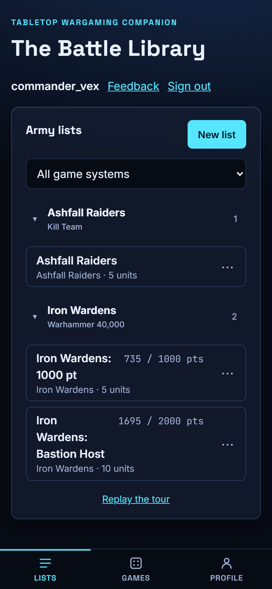</td>
    <td width="33%">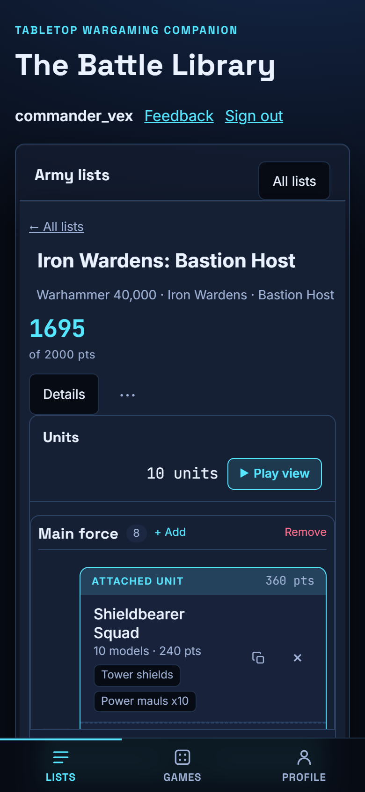</td>
    <td width="33%">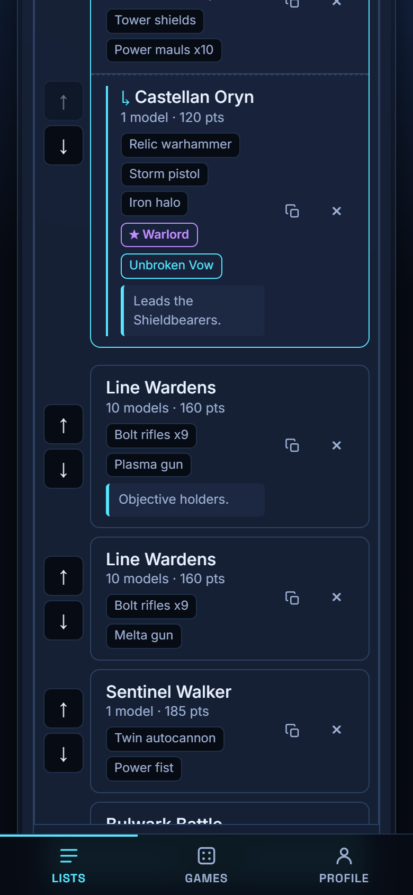</td>
  </tr>
  <tr>
    <td valign="top"><b>Lists</b>, grouped by faction and game system, with points used against the limit.</td>
    <td valign="top"><b>List builder.</b> Named sections, a running total, and a printable play view.</td>
    <td valign="top"><b>Attachments and warlord.</b> A leader attached to a squad, with wargear, an enhancement, and notes.</td>
  </tr>
  <tr>
    <td width="33%">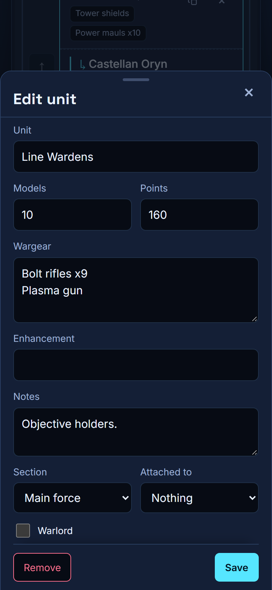</td>
    <td width="33%">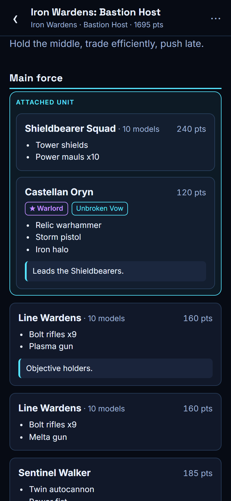</td>
    <td></td>
  </tr>
  <tr>
    <td valign="top"><b>Unit form.</b> A thumb-reachable bottom sheet. Units can be saved as reusable presets.</td>
    <td valign="top"><b>Play view.</b> A clean, read-only layout of the list for use mid-game.</td>
    <td></td>
  </tr>
</table>

## Games

Run a live game for up to four players with real-time scoring over SignalR, or
log a finished game afterwards. History rolls up into a record, win rate, and
timeline.

<table>
  <tr>
    <td width="33%">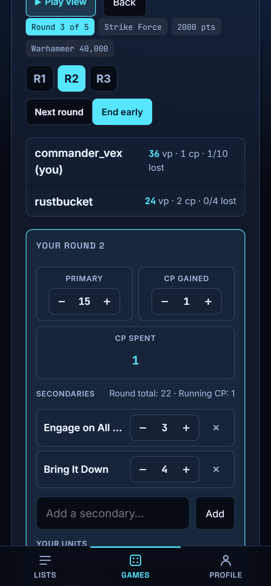</td>
    <td width="33%">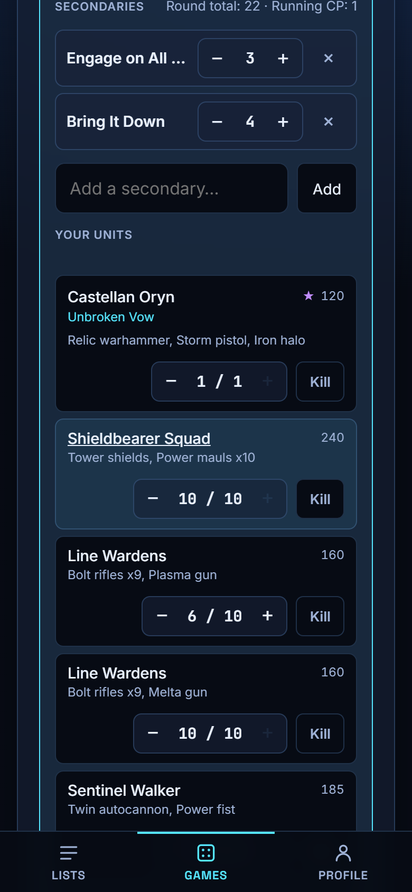</td>
    <td width="33%">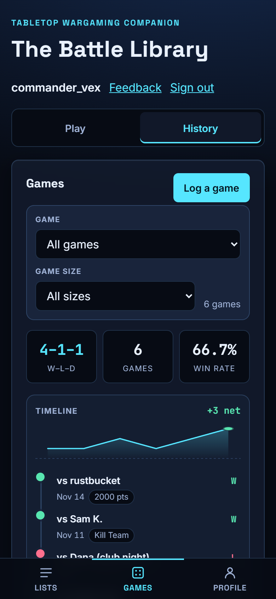</td>
  </tr>
  <tr>
    <td valign="top"><b>Live game.</b> Round-by-round primary score, CP, and a shared scoreboard.</td>
    <td valign="top"><b>Secondaries and units.</b> Track models lost and units destroyed as the game goes.</td>
    <td valign="top"><b>History.</b> Filter by game and size, with W-L-D, win rate, and a timeline.</td>
  </tr>
</table>

## Profiles and friends

<table>
  <tr>
    <td width="33%">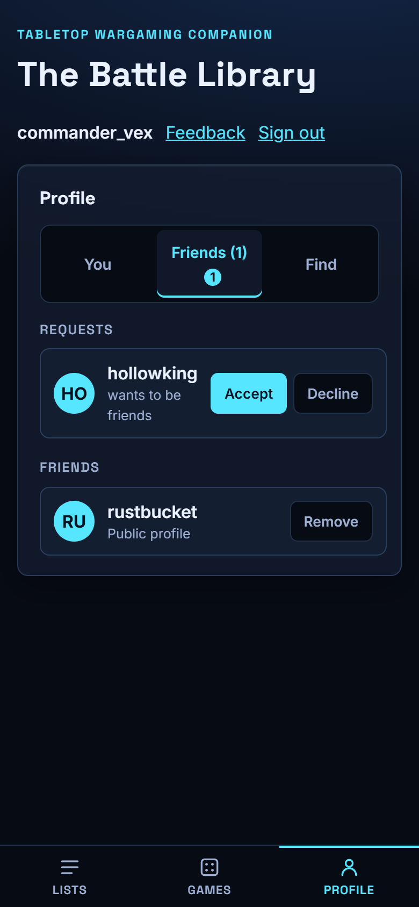</td>
    <td width="33%">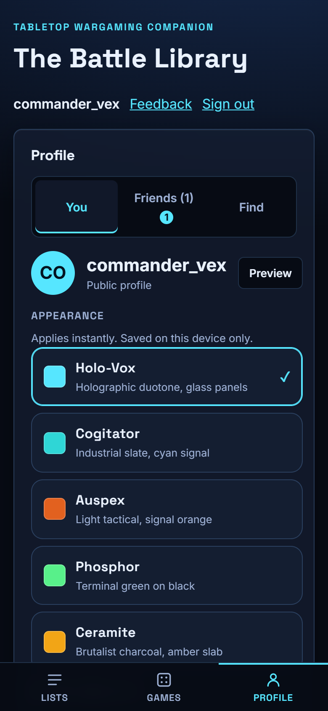</td>
    <td></td>
  </tr>
  <tr>
    <td valign="top"><b>Friends.</b> Username search, requests, and public or private profiles.</td>
    <td valign="top"><b>Profile.</b> Five color themes, applied instantly and saved per device.</td>
    <td></td>
  </tr>
</table>

## Themes

The same list builder in two of the five themes.

<table>
  <tr>
    <td width="33%">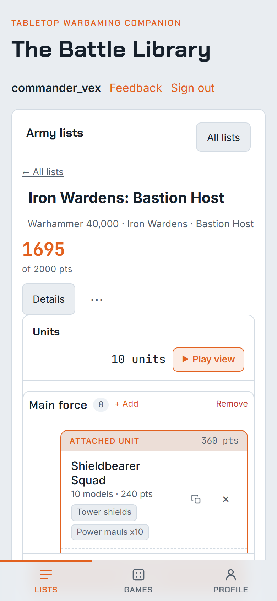</td>
    <td width="33%">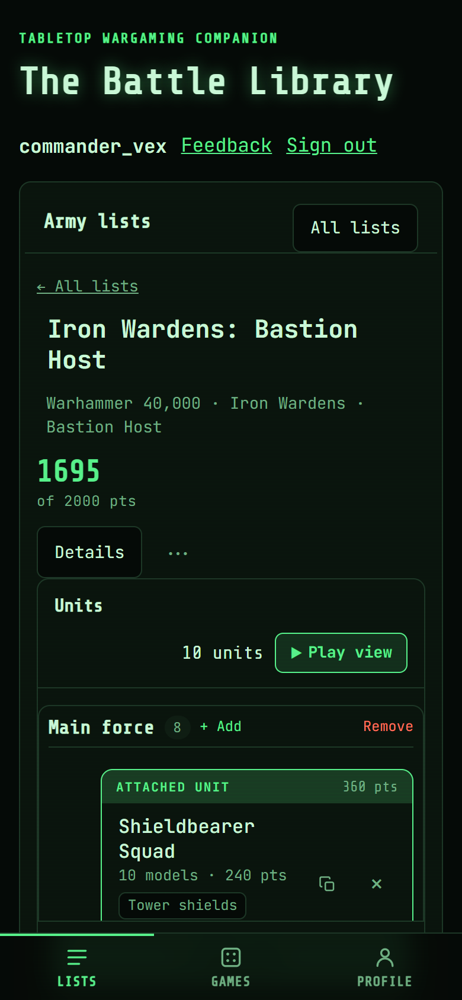</td>
    <td></td>
  </tr>
  <tr>
    <td valign="top"><b>Auspex</b>, a light theme with signal orange.</td>
    <td valign="top"><b>Phosphor</b>, terminal green on black.</td>
    <td></td>
  </tr>
</table>

## Desktop

Mobile first, but the layout widens on larger screens.

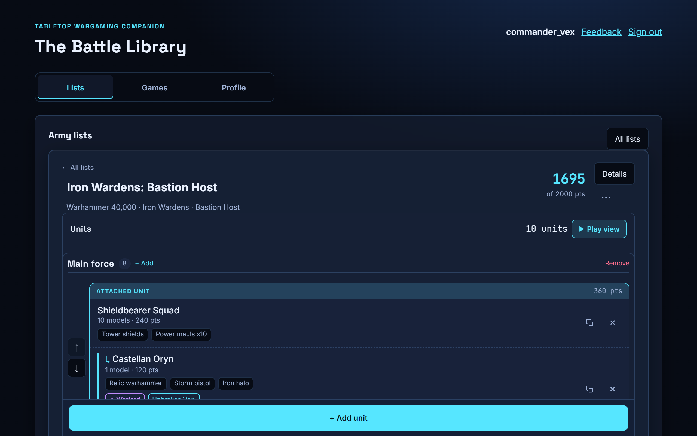
